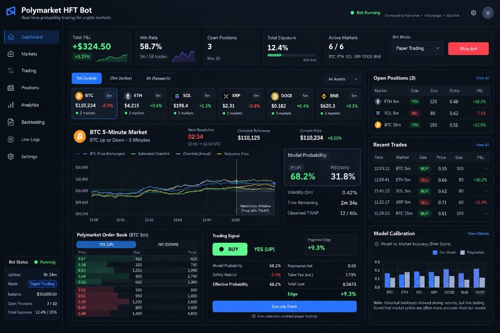

# Polymarket HFT 机器人：使用 Black-Scholes

[English](README.md) | **中文**

**面向 Polymarket 加密货币涨跌（Up/Down）市场的实时概率交易基础设施。**



Polymarket HFT Bot 是一个以研究为导向的交易平台，用来发现 Polymarket 加密货币预测市场中的短期定价偏差。

系统结合了：

* Polymarket CLOB 订单簿数据
* Chainlink 价格源
* 多家交易所的加密货币价格
* 短期波动率
* 市场结算机制
* 面向 5 分钟和 15 分钟涨跌市场的 60 秒 TWAP 概率模型
* 面向可选长期行权价市场的 Black-Scholes 概率模型
* 计入手续费的期望值
* 持仓与组合风险管理

平台持续估计 **上涨（UP）** 或 **下跌（DOWN）** 的公允概率，并与 Polymarket 上当前可成交的价格比较。

当两者的差距大到足以覆盖手续费、滑点和模型不确定性时，系统可以产生交易信号。

> 本项目主要用于研究、策略开发、模拟交易（paper trading）和市场微观结构分析。历史或模拟表现不保证未来盈利。

---

# 概述

Polymarket 的加密货币涨跌市场，根据标的资产在预定结算窗口内最终是否高于或低于参考价来结算。

例如：

```text
BTC Up or Down — 5 Minutes

Reference Price:
$110,125

Current Price:
$110,234

Time Remaining:
2m 34s
```

它不是简单地问：

```text
"比特币现在是在涨吗？"
```

机器人问的是一个更有用的问题：

```text
"最终结算值高于参考价的概率是多少？"
```

估计出的概率再与 Polymarket 给出的价格比较。

示例：

```text
Model P(UP):          68.2%
Safety Haircut:       -2.0%
Effective P(UP):      66.2%

Polymarket YES Ask:   $0.55
Estimated Fee:        $0.0173
Total Cost:           $0.5673

Estimated Edge:       +9.3%
```

如果预期优势（edge）超过配置的交易阈值，策略可以产生：

```text
BUY YES
```

信号。

---

# 支持的市场

平台主要面向短周期加密货币市场。

通常支持的资产包括：

| 资产 | 代码 |
| -------- | ------ |
| 比特币 Bitcoin | BTC |
| 以太坊 Ethereum | ETH |
| Solana | SOL |
| XRP | XRP |
| 狗狗币 Dogecoin | DOGE |
| BNB | BNB |

主要交易窗口：

```text
5 分钟
15 分钟
```

更长周期的市场也可以用于研究和试验。

---

# 策略如何运作

策略可以概括为：

```text
外部加密货币价格
        ↓
Chainlink 价格源
        ↓
市场参考价
        ↓
短期波动率
        ↓
结算概率模型
        ↓
Polymarket 订单簿
        ↓
手续费 + 风险调整
        ↓
估计优势
        ↓
交易 / 忽略
```

---

# 1. 参考价识别

每个涨跌市场都有一个用来判定最终结果的参考价。

示例：

```text
BTC Reference Price
$110,125
```

准确识别这个值至关重要。

参考价只要有很小的误差，就可能制造出虚假的交易机会。

因此，策略应优先使用真实的 Chainlink 参考价，而不是用附近某根交易所 K 线去估计参考价。

概念上：

```text
市场开始
    ↓
捕获精确的 Chainlink 参考价
    ↓
保存参考价
    ↓
在整个市场窗口中使用该参考价
```

---

# 2. 实时加密货币价格汇总

交易引擎可以同时监控多家交易所，例如：

```text
Binance
Coinbase
Kraken
Bybit
OKX
Bitget
```

系统不完全依赖单一场所，而是可以计算一个综合市场价格。

例如：

```text
Binance   $110,240
Coinbase  $110,236
Kraken    $110,238
Bybit     $110,242
OKX       $110,235
Bitget    $110,241

综合价格
≈ $110,239
```

使用多个场所，有助于降低某一家交易所短暂价格异常的影响。

---

# 3. Chainlink 与交易所价格

中心化交易所的行情往往反应极快。

Chainlink 的价格更新可能遵循略有不同的更新过程。

因此系统可以研究下面这条关系：

```text
交易所价格
      ↓
可能的领先
      ↓
Chainlink 价格
      ↓
Polymarket 结算
```

机器人可以估计交易所综合价与 Chainlink 之间的当前差额。

概念上：

```text
基差 =
Chainlink 价格 / 交易所综合价 - 1
```

这些信息可以用来估计 Chainlink 下一步可能往哪里走。

---

# 4. 面向结算的概率模型

策略并不是简单地预测下一笔 BTC 价格。

它尝试估计的是：

```text
P(UP)
```

以及：

```text
P(DOWN)
```

也就是针对 Polymarket 真实结算条件的概率。

示例：

```text
P(UP)   = 68.2%
P(DOWN) = 31.8%
```

模型考虑的变量包括：

```text
当前价格
参考价
剩余时间
短期波动率
已观察到的结算窗口
Chainlink 价格
外部交易所价格
```

这个估计**不是** Black-Scholes 价格。5 分钟和 15 分钟市场按 60 秒 Chainlink TWAP 结算，因此实盘模型是 `bot/updown.py` 中的 `prob_up_twap`（第 5、6 节）。Black-Scholes 是第二个模型，只用于长期行权价市场，并且默认关闭，除非设置 `ENABLE_LONG_MARKETS=true`。见 [Black-Scholes 模型](#black-scholes-模型)。

---

# 5. 最终 TWAP 建模

如果市场的结算依赖一段平均价格，模型就应计入结算窗口中已经发生的部分。

示例：

```text
结算窗口：
60 秒

已观察：
12 秒

剩余：
48 秒
```

最终结果因此取决于：

```text
已观察到的 TWAP
+
预期的未来价格路径
```

而不是只看最新的现货价格。

这在临近到期时尤其重要。

---

# 6. 短期波动率

概率模型需要一个对不确定性的估计。

引擎可以用最近的加密货币收益率计算短期已实现波动率。

概念上：

```text
最近的 1 分钟价格
        ↓
对数收益
        ↓
标准差
        ↓
短期波动率估计
```

仪表盘上的示例数值：

```text
1 分钟波动率：
0.42%
```

波动率越高，最终结果周围的不确定性通常越大。

---

# Black-Scholes 模型

机器人有两套概率模型。它们回答的是不同的结算问题，其中只有一套是 Black-Scholes。

| | 5 分钟和 15 分钟涨跌（默认） | 长期行权价市场（可选） |
|---|---|---|
| 代码 | `bot/updown.py` 中的 `prob_up_twap` | `bot/analyzer.py` 中的 `_black_scholes_probability` |
| 问题 | 最后 **60 秒** 的 Chainlink TWAP 是否会落在窗口开盘价之上或与之持平？ | 现货在数天或数月后的到期日，是否会收在某个美元行权价之上（或之下）？ |
| 模型 | 对该 TWAP 的正态模型，波动率按每平方根秒计 | Black-Scholes，零漂移：`P(S_T > K) = N(d2)` |
| 默认开启 | 是 | 否。需设置 `ENABLE_LONG_MARKETS=true` |

## 涨跌机器人不使用的部分

这个机器人默认交易的市场，并不是按“期末价格相对一个遥远行权价”来结算的。经典的 Black-Scholes `d2` 会回答错误的问题。实盘路径使用第 5、6 节的 TWAP 模型，再减去 taker 手续费和 2% 的安全扣减，然后才与 Polymarket 的卖价（ask）比较。

## Black-Scholes 用在哪里

只有在启用长期市场时，`MarketAnalyzer._analyze_market` 才会运行。`MarketScanner` 保留那些点明了资产和美元目标价的问题，例如 “Will Bitcoin be above $100,000 by [date]?”。加密货币的现货来自 Binance，黄金、白银和原油来自 Yahoo Finance。到期时间来自市场的结束日期。

价格被建模为**没有漂移**的几何布朗运动。利率为零时，收在行权价之上的风险中性概率就是 Black-Scholes 中的 `N(d2)`：

```text
P(S_T > K) = N(d2)

d2 = (ln(S / K) - 0.5 · σ² · T) / (σ · √T)
```

| 符号 | 在本机器人中的含义 |
|---|---|
| `S` | 当前现货价格 |
| `K` | 从问题文本中解析出的美元目标价 |
| `T` | 距离到期的天数 / 365 |
| `σ` | 由最近日对数收益算出的年化已实现波动率。如果缺少历史数据，则使用各资产的默认值（例如 BTC 为 65%，黄金为 15%） |
| `N` | 标准正态分布的累积分布函数 |

问题是“低于”目标价的市场，使用 `1 - P(S_T > K)`。

如果市场已经到期（`T = 0`），概率为 `1` 或 `0`，取决于现货是否已经越过行权价。如果 `σ` 或 `T` 不是正数，函数返回 `0.5`。

## 障碍市场

有些问题只要价格在任意时刻**触及**某个水平就会赔付（“hit”、“reach”、“dip”），而不是只有收在那里才赔付。这些不是普通的 Black-Scholes 期末概率。如果该水平尚未被触及，代码使用无漂移的反射原理，大约取 `2 · N(d2)`，并封顶在 `0.99`。如果现货已经穿过该水平，概率设为 `0.99`。

## 这个概率如何变成一笔交易

Black-Scholes 概率会同时与 Polymarket 上的 YES 价格和 NO 价格比较。差距较大的一侧，只有在下面全部成立时才会保留：

* 优势至少达到 `MIN_EDGE`，并且不超过 35%（更大的差距被视为解析错误或模型错误，而不是免费的钱）
* 获胜概率至少达到 `MIN_WIN_PROBABILITY`
* 每 1 USDC 的期望值至少达到 `MIN_EXPECTED_VALUE`
* 分数 Kelly 仓位为正

每投入 1 USDC 的期望值是 `true_probability / market_price - 1`。Kelly 使用净赔率 `b = 1/price - 1`，再乘以 `KELLY_FRACTION`。

## 这条路径不是什么

`ENABLE_LONG_MARKETS` 默认为 `false`。打开之后，交易的是可能把资金锁定数月的市场，而且这条路径没有用涨跌市场的实盘日志（`calibration.py`）检验过。它不替代 5 分钟和 15 分钟的 TWAP 模型，也不像期权交易台那样给合约权利金定价。它只估计价格最终落在行权价某一侧的概率，再把这个概率与 Polymarket 的价格比较。

---

# 7. Polymarket 订单簿

机器人从 Polymarket CLOB 读取可成交价格。

示例：

```text
YES

Price    Size
0.57     420
0.56     320
0.55     1,250
0.54     800


NO

Price    Size
0.52     500
0.51     950
0.50     1,200
0.49     800
```

策略应使用可成交的买价和卖价（bid/ask），而不是只依赖中间价。

这一点很重要，因为一个理论上的机会，在计入下面这些因素之后可能会消失：

```text
价差
手续费
滑点
延迟
有限的流动性
```

---

# 8. 公允价值与市场价格

假设模型算出：

```text
P(UP) = 68.2%
```

可以再做一个安全调整：

```text
模型概率：
68.2%

安全扣减：
-2.0%

有效概率：
66.2%
```

假设 Polymarket 上 YES 的卖价是：

```text
$0.55
```

计入手续费之后：

```text
总成本：
$0.5673
```

估计优势：

```text
66.2%
-
56.73%
=
+9.47%
```

如果配置的最小优势是：

```text
8%
```

系统就可以产生：

```text
BUY YES
```

---

# 交易信号引擎

只有当所有必要条件都满足时，才应考虑一笔交易。

示例：

```text
已有精确参考价              ✓
市场处于活跃状态            ✓
剩余时间充足                ✓
订单簿有足够流动性          ✓
价格在允许区间内            ✓
风险限额仍有空间            ✓
估计优势 > 阈值             ✓
```

然后：

```text
信号

买入
YES / UP

预计优势
+9.3%
```

否则：

```text
不交易
```

---

# 仓位大小

系统可以使用分数 Kelly 来决定仓位。

目的不是单纯把单笔交易做得越大越好。

仓位会同时考虑：

```text
估计概率
入场成本
可用余额
预期优势
组合敞口
最大单笔仓位
```

分数 Kelly 可以降低不完美模型概率带来的风险。

例如：

```text
完整 Kelly：
12%

配置的 Kelly 比例：
25%

实际建议配置：
3%
```

---

# 组合风险管理

加密货币预测市场高度相关。

同时持有：

```text
BTC YES
ETH YES
SOL YES
BNB YES
```

并不等于四笔相互独立的交易。

一轮广泛的加密货币行情，可能同时影响这四笔。

因此平台会跟踪：

```text
总敞口
未平仓持仓
单个市场敞口
单个资产敞口
最大单笔仓位
组合敞口上限
挂单中的订单
```

示例：

```text
余额：
$10,000

当前敞口：
12.4%

最大敞口：
25%
```

---

# 退出逻辑

平台可以支持多种退出方式。

## 按公允价值退出

假设：

```text
模型公允价值：
$0.62

Polymarket 买价：
$0.70
```

如果 Polymarket 现在给出的价格已经明显高于模型认为该持仓值的价格，机器人可以平掉这笔交易。

概念上：

```text
市场价格相对模型变得过贵
        ↓
卖出
```

---

## 利润锁定

持仓在达到配置的收益率后，可以选择平仓。

示例：

```text
入场：
$0.40

当前净值：
$0.53

收益：
+32.5%
```

如果配置的利润锁定阈值是：

```text
30%
```

这笔持仓就可以平掉。

---

## 持有至结算

机器人也可以把持仓一直拿到结算。

结算时：

```text
获胜的份额 → $1
失败的份额 → $0
```

这样就不必再做一次市场卖出，但会承担完整的结算风险。

---

# 仪表盘

网页仪表盘的设计目标，是让用户用一个界面监控策略行为。页面布局见本页顶部的图片。

主导航：

```text
仪表盘
市场
交易
持仓
分析
回测
实时日志
设置
```

---

# 仪表盘概览

主仪表盘展示策略的关键统计。

示例：

```text
总盈亏
+$324.50

收益率
+3.25%

胜率
58.7%

未平仓持仓
3

组合敞口
12.4%

活跃市场
6 / 6
```

---

# 市场监控

用户可以在不同的市场时长之间切换。

```text
5 分钟
15 分钟
4 小时
```

并监控这些资产：

```text
BTC
ETH
SOL
XRP
DOGE
BNB
```

每张市场卡片可以显示：

```text
当前价格
价格变动
市场时长
市场状态
活跃市场数量
```

---

# 实时价格图

主市场图可以同时显示多个数据源。

例如：

```text
BTC 交易所价格
估计的 Chainlink
实际的 Chainlink
参考价
```

这样用户可以直观地查看：

```text
交易所价格的变动
Chainlink 的响应
与参考价的距离
结算窗口
```

并且是实时的。

---

# 模型概率面板

模型区域显示当前估计：

```text
P(UP)
68.2%

P(DOWN)
31.8%
```

其他信息：

```text
波动率
0.42%

剩余时间
2 分 34 秒

已观察的 TWAP
12 / 60 秒
```

---

# 交易面板

执行之前，界面会展示这条信号背后的完整推理。

示例：

```text
信号
买入 YES

模型概率
68.2%

安全扣减
-2.0%

有效概率
66.2%

Polymarket 卖价
$0.55

估计手续费
1.73%

总成本
$0.5673

估计优势
+9.3%
```

然后用户可以根据配置，在下面两者之间选择：

```text
手动执行
```

或：

```text
自动执行
```

---

# 未平仓持仓

用户可以监控所有活跃持仓。

示例：

| 市场 | 方向 | 数量 | 入场价 | 盈亏 |
| ------- | ---: | ---: | ----: | -----: |
| ETH 5m | YES | 120 | 0.48 | +18.2% |
| SOL 5m | NO | 80 | 0.62 | -7.1% |
| BTC 15m | YES | 150 | 0.51 | +12.5% |

---

# 最近成交

仪表盘也会保留成交历史。

示例：

| 时间 | 市场 | 方向 | 价格 | 数量 | 盈亏 |
| -------- | ------ | ---- | ----: | ---: | -----: |
| 12:03:12 | BTC 5m | 买入 | 0.55 | 100 | — |
| 11:58:41 | ETH 5m | 卖出 | 0.66 | 80 | +30.2% |
| 11:45:22 | SOL 5m | 买入 | 0.62 | 80 | — |

---

# 分析

一套认真的交易系统应当持续评估模型。

有用的指标包括：

```text
Brier 分数
校准误差
预测准确率
期望值
已实现盈亏
胜率
平均盈利
平均亏损
滑点
成交率
信号频率
入场时的优势
计入延迟后的优势
```

---

# 模型校准

平台应当比较：

```text
我们的模型
对比
Polymarket 的市场概率
```

这一点极其重要。

模型产生很多信号，并不自动意味着模型含有有用的信息。

例如：

```text
模型：
P(UP) = 70%

市场：
P(UP) = 56%
```

重要的问题不是：

```text
"是不是有 14% 的差距？"
```

重要的问题是：

```text
"哪一个概率
相对未来的真实结果校准得更好？"
```

分析部分应当把这一点显示出来。

---

# 回测

平台可以支持历史策略分析。

不过，预测市场的回测需要格外小心。

一次回测理想情况下应使用时间对齐的：

```text
Polymarket 订单簿更新
中心化交易所成交
中心化交易所订单簿
Chainlink 更新
参考价
结算结果
```

分钟级的 Polymarket 数据，不应被当成与秒级或毫秒级可成交价格等价。

否则，陈旧价格偏差会制造出不真实的历史利润。

---

# 为什么回测会误导人

考虑：

```text
12:03:00
Polymarket YES = $0.42

12:03:35
BTC 大幅上涨
```

如果回测错误地把下面两样拼在一起：

```text
12:03:35 的 BTC 价格

与

12:03:00 的 Polymarket 价格
```

它可能算出：

```text
模型概率：
64%

Polymarket：
42%

表面上的优势：
22%
```

但 12:03:35 时 Polymarket 的真实价格可能已经变成：

```text
$0.63
```

因此真实优势可能几乎为零。

这就是为什么，对高频风格的研究来说，真实的时间戳对齐是必要的。

---

# 模拟交易

在任何实盘执行之前，建议先使用模拟交易（Paper Trading）模式。

模拟模式应当模拟：

```text
真实订单簿
真实价差
真实手续费
执行延迟
滑点
流动性限制
仓位大小
退出规则
```

而不是简单地假设每个信号都能按希望的价格成交。

仪表盘上的模式示例：

```text
机器人模式：
模拟交易
```

---

# 实盘交易

只有在下面这些都完成之后，才应开启实盘交易：

```text
策略验证
执行测试
API 验证
风险验证
模拟交易
模型校准
```

建议的推进顺序：

```text
研究
   ↓
回测
   ↓
历史订单簿回放
   ↓
模拟交易
   ↓
小资金实盘测试
   ↓
绩效复盘
   ↓
逐步放大
```

---

# 实时日志

实时日志页面用来观察机器人的行为。

示例：

```text
[12:03:10] 已捕获 BTC 参考价：110125.24

[12:03:11] BTC 当前 Chainlink：110234.18

[12:03:11] 模型 P(UP)：0.682

[12:03:11] Polymarket YES 卖价：0.55

[12:03:11] 有效优势：+9.3%

[12:03:11] 已产生买入信号

[12:03:12] 订单已提交

[12:03:12] 持仓已开立
```

有用的日志包括：

```text
市场发现
价格源更新
参考价捕获
概率计算
交易信号
订单执行
风险拒绝
持仓更新
退出信号
错误
连接状态
```

---

# 系统架构

简化后的架构：

```text
             ┌──────────────────┐
             │ Binance          │
             │ Coinbase         │
             │ Kraken           │
             │ Bybit            │
             │ OKX              │
             │ Bitget           │
             └────────┬─────────┘
                      │
                      ▼
             ┌──────────────────┐
             │ 价格汇总         │
             └────────┬─────────┘
                      │
             ┌────────▼─────────┐
             │ Chainlink 价格源 │
             └────────┬─────────┘
                      │
                      ▼
            ┌────────────────────┐
            │ 概率引擎           │
            └─────────┬──────────┘
                      │
              ┌───────▼────────┐
              │ Polymarket CLOB│
              └───────┬────────┘
                      │
                      ▼
              ┌────────────────┐
              │ 信号引擎       │
              └───────┬────────┘
                      │
              ┌───────▼────────┐
              │ 风险管理       │
              └───────┬────────┘
                      │
                      ▼
              ┌────────────────┐
              │ 订单执行       │
              └───────┬────────┘
                      │
                      ▼
              ┌────────────────┐
              │ 持仓管理       │
              └───────┬────────┘
                      │
                      ▼
              ┌────────────────┐
              │ 网页仪表盘     │
              └────────────────┘
```

---

# 建议的项目结构

```text
polymarket-hft/
│
├── backend/
│   ├── feeds/
│   │   ├── chainlink/
│   │   ├── polymarket/
│   │   └── exchanges/
│   │
│   ├── strategy/
│   │   ├── probability/
│   │   ├── signals/
│   │   └── calibration/
│   │
│   ├── execution/
│   │   ├── orders/
│   │   ├── positions/
│   │   └── risk/
│   │
│   ├── analytics/
│   └── api/
│
├── frontend/
│   ├── dashboard/
│   ├── markets/
│   ├── trading/
│   ├── positions/
│   ├── analytics/
│   ├── backtesting/
│   ├── logs/
│   └── settings/
│
├── research/
├── tests/
├── docs/
└── README.md
```

---

# 推荐配置

配置示例：

```env
# 交易

TRADING_MODE=paper

MIN_EDGE=0.08

MODEL_HAIRCUT=0.02

KELLY_FRACTION=0.25

MAX_PORTFOLIO_EXPOSURE=0.25

MAX_OPEN_POSITIONS=10


# 策略

ENABLE_5M=true

ENABLE_15M=true

REQUIRE_EXACT_REFERENCE=true


# 资产

BTC_ENABLED=true

ETH_ENABLED=true

SOL_ENABLED=true

XRP_ENABLED=true

DOGE_ENABLED=true

BNB_ENABLED=true
```

不要把私钥、API 密钥、钱包凭证或敏感配置提交到 GitHub。

---

# 安全

交易基础设施应遵守严格的凭证管理。

绝不要在源代码中直接存放：

```text
私钥
助记词
交易所 API 密钥
钱包认证密钥
```

尽可能使用：

```text
环境变量
密钥管理服务
权限受限的 API
专用交易钱包
已关闭提现的 API 密钥
```

---

# 当前策略状态

本仓库不应把策略描述成保证盈利。

底层策略是一套仍在研究中的系统。

历史模拟可能看起来不错，而实盘或更接近真实的执行可能结果差很多，原因包括：

```text
市场有效性
延迟
滑点
手续费
模型误差
陈旧数据
市场环境变化
流动性
相关性
```

因此，这个平台的首要目标不只是执行交易，还包括持续判断策略是否真的具有可测量的预测优势。

---

# 我们在研究什么

后续策略研究可能包括：

```text
中心化交易所订单流不平衡

订单簿不平衡

微观价格

主动成交方向

跨交易所领先 / 滞后

Chainlink 更新预测

Polymarket 订单簿动态

短期动量

清算数据

永续合约基差

CVD

OFI

波动率状态

机器学习概率模型
```

目标是判断：外部市场信息能否在被完全反映进 Polymarket 价格之前，稳定地到达交易引擎。

---

# 路线图

## 第一阶段 — 基础设施

* [x] 实时市场监控
* [x] Chainlink 接入
* [x] 多交易所价格
* [x] Polymarket 订单簿
* [x] 概率建模
* [x] 模拟交易引擎
* [x] 持仓管理

## 第二阶段 — 网页平台

* [ ] 专业交易仪表盘
* [ ] 市场浏览器
* [ ] 持仓管理界面
* [ ] 成交历史
* [ ] 实时策略日志
* [ ] 模型分析
* [ ] 回测界面
* [ ] 用户设置

## 第三阶段 — 研究

* [ ] 订单流模型
* [ ] 订单簿不平衡
* [ ] 跨交易所延迟分析
* [ ] Chainlink 领先 / 滞后分析
* [ ] 概率校准
* [ ] 市场状态识别
* [ ] 策略比较

## 第四阶段 — 进阶交易

* [ ] 自动执行
* [ ] 多策略支持
* [ ] 进阶风险管理
* [ ] 组合优化
* [ ] 策略绩效归因

---

# 这个项目适合谁

本项目可能对以下人群有用：

```text
预测市场研究者
量化交易者
Polymarket 开发者
加密货币交易机器人开发者
市场微观结构研究者
数据科学家
算法交易者
```

它也可以作为测试新的 Polymarket 交易策略的基础设施。

---

# 重要原则

本项目的核心想法是：

> 模型与市场之间的差异，并不自动就是机会。

真正的交易优势，只有在模型提供的信息同时满足下面这些条件时才存在：

```text
更准确
+
更早可得
+
扣除手续费后仍可执行
+
扣除滑点后仍可执行
+
可以随时间重复
```

并且这些信息要优于市场已经反映出来的信息。

---

# 免责声明

本软件仅供教育、研究和实验使用。

预测市场和加密货币交易涉及重大财务风险。

本仓库中的任何内容都不应被视为：

```text
财务建议
投资建议
盈利保证
交易推荐
```

用户有责任自行了解适用的法规、平台规则、市场风险、钱包安全、执行风险以及可能的财务损失。

在使用真实资金之前，请始终独立验证策略。

---

# 贡献

欢迎研究、缺陷报告、策略讨论和改进。

可能的贡献方向包括：

```text
市场数据
执行
回测
概率模型
界面 / 体验
风险管理
分析
性能优化
测试
文档
```

---

# 最终目标

Polymarket HFT Bot 的长期目标，不是再写一个自动交易脚本。

目标是搭建一个专业的研究与交易环境，让用户可以：

```text
观察市场
        ↓
理解信号
        ↓
测试策略
        ↓
测量真实优势
        ↓
模拟交易
        ↓
分析表现
        ↓
改进模型
        ↓
谨慎部署
```

并且使用透明的数据、接近真实的执行假设，以及可测量的风险。
